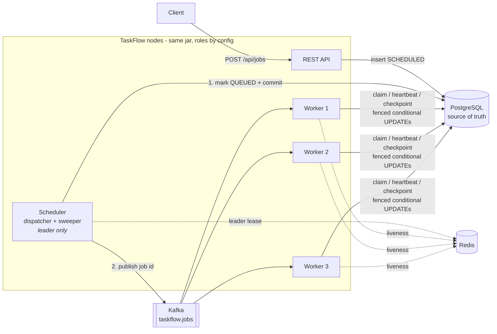
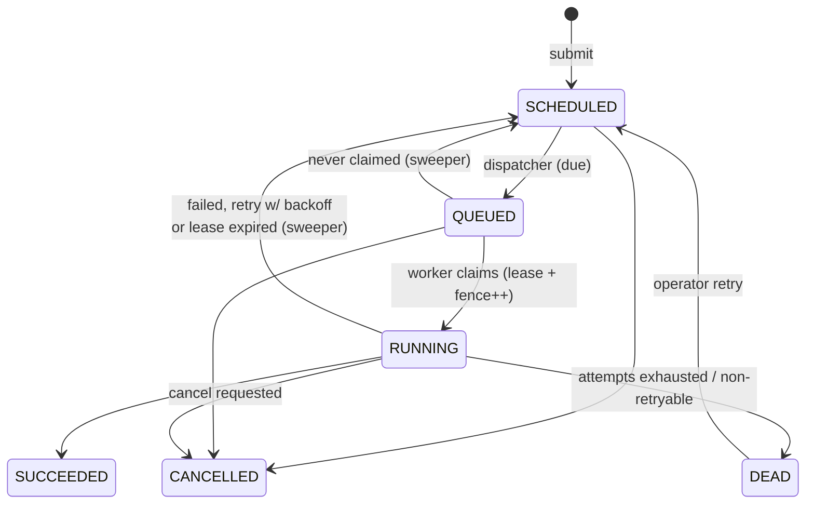

# TaskFlow

**A distributed job execution platform that keeps long-running work alive through worker crashes, network stalls and lost messages.**

Submit a job over HTTP; TaskFlow dispatches it through Kafka to a fleet of workers, tracks ownership with
leases in Postgres, checkpoints progress, retries failures with backoff, and, when a worker dies mid-job,
hands the job to another worker that **resumes from the last checkpoint instead of starting over**.

Java 21 · Spring Boot 4 · Kafka · PostgreSQL · Redis · Docker · JUnit 5 · Testcontainers

---

## The problem

Background work (report generation, bulk emails, data exports, billing runs) is easy to start and hard to
finish reliably. In a real fleet:

- workers get OOM-killed, redeployed or preempted halfway through a 20-minute job
- a worker can stall (GC pause, network partition), get presumed dead, then wake up and keep writing
- message brokers deliver twice, or a message is lost between "saved" and "published"
- clients retry `POST` requests and accidentally create duplicate jobs

TaskFlow is built around those failure modes.

## Architecture



**Postgres is the source of truth; Kafka is only a doorbell.** A Kafka message just says "look at job X".
Every state change is a single conditional `UPDATE`, so duplicate, late or lost messages can never corrupt a
job; at worst they cause a no-op.

### Job lifecycle



## How reliability is achieved

| Mechanism | What it protects against | Where |
|---|---|---|
| **Leases + heartbeats** | Worker crashes. A job is owned only while its worker keeps renewing the lease; the sweeper reclaims expired ones. | `JobRepository.claim/heartbeat`, `Sweeper` |
| **Fencing tokens** | "Zombie" workers. `fence` increments on every claim, and every worker write is `WHERE fence = :myFence`, so a worker that stalled past its lease can't overwrite its successor's work. | `JobRepository` (all worker writes) |
| **Checkpoints** | Losing hours of progress. Handlers persist progress (fenced); the next attempt resumes from it. | `JobContext.checkpoint` |
| **Commit-then-publish dispatch** | Lost or early messages (see below). Jobs stuck in `QUEUED` are re-dispatched. | `Dispatcher`, `Sweeper` |
| **`FOR UPDATE SKIP LOCKED`** | Two schedulers dispatching the same job. Leader election is an optimization, not a correctness requirement. | `markDueJobsQueued`, `recoverExpiredLeases` |
| **Idempotency keys** | Client retries creating duplicate jobs. | `POST /api/jobs` + unique index |
| **Exponential backoff with jitter** | Retry storms against a struggling dependency. | `BackoffPolicy` |
| **Bounded worker slots** | Overload. A worker takes a slot *before* claiming, so a claimed job never waits for a thread while its lease ticks. | `WorkerNode` |
| **Graceful drain** | Deploys. On shutdown a worker stops intake, lets jobs stop at their next checkpoint and hands them back **without consuming an attempt**. | `WorkerNode.stop`, `JobRepository.release` |

**Delivery semantics:** execution is *at-least-once* (a job may run again after a crash), while state
transitions are *exactly-once* thanks to fencing. Handlers are written to be safe to re-run, and checkpoints
make re-running cheap.

### A bug the tests caught: the commit-ordering race

The first version of the dispatcher marked jobs `QUEUED` and published to Kafka **inside the same
transaction**. Under load (150 concurrent jobs) about 20% of jobs never ran. A thread dump showed idle
consumers, and the event history showed jobs looping `DISPATCHED → REDELIVERED → DISPATCHED`.

The cause: workers were fast enough to receive the Kafka message **before the dispatcher's transaction
committed**. Under `READ COMMITTED`, the worker's `UPDATE … WHERE status = 'QUEUED'` saw the old `SCHEDULED`
row, matched nothing, and the message was dropped. Every redelivery hit the same race.

The fix is to **commit first, then publish**. If publishing fails, the batch is reverted to `SCHEDULED`
immediately. If the process dies between commit and publish, the sweeper re-dispatches jobs that stay
`QUEUED` too long. `manyConcurrentJobsAreEachExecutedExactlyOnce` is the regression test: 150 jobs, each
must show exactly `SUBMITTED → DISPATCHED → CLAIMED → SUCCEEDED`.

## Running it

**Prerequisites:** Docker. Java 21 is only needed to run the tests locally.

```bash
docker compose up --build -d          # postgres, kafka, redis, 1 api node, 3 workers
./scripts/demo.sh                     # one job of each kind: success, retry, poison, idempotency
./scripts/chaos.sh                    # kill the worker running a long job and watch it recover
```

`chaos.sh` submits a 5,000-row report job, waits until it is ~20% done, `docker kill`s the worker that holds
its lease, and then prints the job's history: `CLAIMED` (worker A), `LEASE_EXPIRED`, `DISPATCHED`, `CLAIMED`
(worker B, *"Resuming from checkpoint"*), `SUCCEEDED`, followed by the result and the expected checksum.

The checksum is the sum of all row numbers, so it only matches if the resumed run neither skipped nor
double-counted a chunk.

### API

| Method | Path | Description |
|---|---|---|
| `POST` | `/api/jobs` | Submit `{type, payload, priority?, maxAttempts?, delaySeconds?}`. Optional `Idempotency-Key` header. `201` for new, `200` for a duplicate key. |
| `GET` | `/api/jobs/{id}` | Job state, progress, checkpoint, result, last error |
| `GET` | `/api/jobs?status=&type=&limit=` | List jobs |
| `GET` | `/api/jobs/{id}/events` | Full history: claims, retries, lease expiries, recoveries |
| `POST` | `/api/jobs/{id}/cancel` | Cancel (immediate if not started; cooperative if running) |
| `POST` | `/api/jobs/{id}/retry` | Revive a `DEAD`/`CANCELLED` job; it resumes from its checkpoint |
| `GET` | `/api/stats`, `/api/workers`, `/api/job-types` | Fleet overview |
| `GET` | `/actuator/prometheus` | Metrics: dispatched, claimed/skipped, outcomes, durations, recoveries |

### Writing a job type

```java
@Component
public class InvoiceExportHandler implements JobHandler {
    public String type() { return "invoice.export"; }

    public Map<String, Object> execute(JobContext ctx) {
        long cursor = ((Number) ctx.checkpoint().getOrDefault("cursor", 0)).longValue();
        while (cursor < total) {
            cursor = exportPage(cursor);                       // your work
            ctx.checkpoint(Map.of("cursor", cursor), percent); // durable, fenced, cancellable
        }
        return Map.of("exported", total);
    }
}
```

Throw `NonRetryableJobException` for failures that retrying can't fix.

## Testing

```bash
./mvnw verify
```

The integration suite boots the **whole application against a real Postgres and a real Kafka broker running
in-process** (embedded Postgres + embedded KRaft Kafka), so it needs no Docker. The Redis lock test uses
Testcontainers and runs wherever Docker is available (it does in CI).

| Test | What it proves |
|---|---|
| `CrashRecoveryTest.jobFromCrashedWorkerIsRecoveredAndResumedFromCheckpoint` | A "ghost" worker claims a job, checkpoints 40%, then stops heartbeating. The job is recovered, re-dispatched and finished by a real worker from offset 400, with a correct checksum. |
| `CrashRecoveryTest.staleWorkerCannotOverwriteStateAfterLosingItsLease` | After recovery, every write with the old fence (checkpoint, fail, heartbeat) is rejected. |
| `CrashRecoveryTest.queuedJobWhoseMessageWasLostIsRedelivered` | A job marked `QUEUED` whose message never arrived is re-dispatched. |
| `JobLifecycleTest.manyConcurrentJobsAreEachExecutedExactlyOnce` | 150 concurrent jobs, each claimed exactly once (regression test for the race above). |
| `JobLifecycleTest.*` | Retries with backoff, attempt exhaustion, non-retryable failures, operator revive, cancelling a running job. |
| `JobApiTest.*` | Idempotency keys, validation, history endpoint, error codes. |
| `LeaderLockTest` / `RedisLeaderLockTest` | One lock contract (exclusive, renewable, expiring, owner-only release) run against both backends. |

## Design decisions and trade-offs

- **Why not just Kafka offsets for job state?** Offsets can't express "running on worker 3 until 10:42",
  progress or retries scheduled for later, and they make "what happened to job X?" hard to answer. Postgres
  gives transactional, queryable state; Kafka gives low-latency fan-out to workers.
- **Why commit Kafka offsets right after claiming?** Once a job is claimed, its fate is tracked by the lease.
  Holding the offset for the whole job would block the partition behind long jobs and tie recovery to
  consumer-group rebalances.
- **Why is leader election allowed to be wrong?** Redis leases can overlap during clock jumps or partitions.
  The dispatcher and sweeper only use row-locked, conditional updates, so two leaders waste a little work but
  can't double-dispatch. That's why the lock can safely be Redis (or Postgres: set
  `TASKFLOW_COORDINATION=postgres`).
- **Priority is best-effort.** Due jobs are dispatched in priority order, but Kafka partitions are FIFO, so a
  high-priority job can wait behind already-queued work on its partition. Separate topics per priority class
  would be the next step.
- **Polling the jobs table** costs one indexed query per interval. Partial indexes keep it cheap; at much
  higher scale, `LISTEN/NOTIFY` or CDC could replace polling.

## Project layout

```
src/main/java/com/taskflow
├── api/            REST controllers, error mapping
├── job/            Job model, repository (all SQL / state transitions), service, backoff
├── dispatch/       Dispatcher (SCHEDULED → QUEUED → Kafka), Sweeper (recovery)
├── worker/         WorkerNode (claim, run, heartbeat, drain), JobContext, handlers/
├── coordination/   Leader election + worker registry (Redis or Postgres)
└── config/         Properties, Kafka topic, node identity
```

## Roadmap

- Per-type concurrency limits and rate limits (token bucket in Redis)
- Job dependencies (DAGs) and scheduled/cron jobs
- Web dashboard for the fleet and job timelines
- Load test harness with published throughput/latency numbers on a multi-node setup
